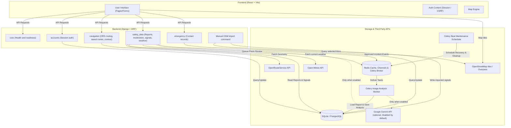

# Lock-Ad v3 System Architecture

Lock-Ad v3 is designed as a modular, safety-aware navigation platform for the Philippines. This folder serves as the central documentation for the system's structural layout, showing how current components function and where future components will integrate.

## System Topology

Below is the high-level flow of the application:

---

## Architectural Principles

1. **Separation of Concerns**: Backend business logic is split into standalone Django applications (`accounts`, `navigation`, `core`, `safety_data`, and `emergency`). The frontend interacts with these via JSON API endpoints.
2. **Backend-Heavy Routing**: Route calculations, provider keys, and mapped route-context summaries stay on the backend. The frontend remains thin and presentational; no uncalibrated safety score is exposed.
3. **Session-Based State**: User sessions are persisted via standard secure Django session cookies instead of local state storage, protecting against XSS token extraction.
4. **Advisory Framing**: System interfaces and data pipelines are built to communicate *cautious advice* rather than absolute safety guarantees.

## Documentation Map

To deep dive into specific layers of the system:
- **[Backend Guide](../docs/BACKEND.md)**: Django apps, local setup, configuration, and operational dependencies.
- **[Backend Architecture](backend.md)**: Django domain behavior, authentication, report processing, and routing internals.
- **[API Reference](../docs/API_REFERENCE.md)**: Canonical endpoint contracts and permissions.
- **[Data Sources and Coverage](../docs/DATA_SOURCES_AND_COVERAGE.md)**: Current providers, imports, provenance, and limitations.
- **[User Guide](../docs/USER_GUIDE.md)**: Current end-user workflows and limitations.
- **[Frontend Architecture](frontend.md)**: Details the Vite build structure, React routing, guard components, and auth providers.
- **[Operations Guide](../docs/OPERATIONS.md)**: Deployment, backups, workers, and recovery.
- **[Privacy and AI](../docs/PRIVACY_AND_AI.md)**: Report access and optional Gemini processing.
- **[Architecture decisions](decisions/001-session-authentication.md)**: Session authentication. See also [RBAC/queryset isolation](decisions/002-rbac-queryset-isolation.md) and [accessibility standards](decisions/003-accessibility-standards.md).
- **[Long-Term Product Vision](../docs/Lock-Ad_v3_Long-Term_Vision.md)**: Explains product philosophy and the staging plan for community and AI features.

---

## Navigation & Product Vocabulary

Always use the following vocabulary across the codebase and user interface:

| Preferred Vocabulary | Unacceptable Vocabulary |
| :--- | :--- |
| `cautious route` | `guaranteed safe route` |
| `risk-aware route` | `crime-free path` |
| `safety-related signals` | `protected route` |
| `route context / advisory` | `secure navigation` |
